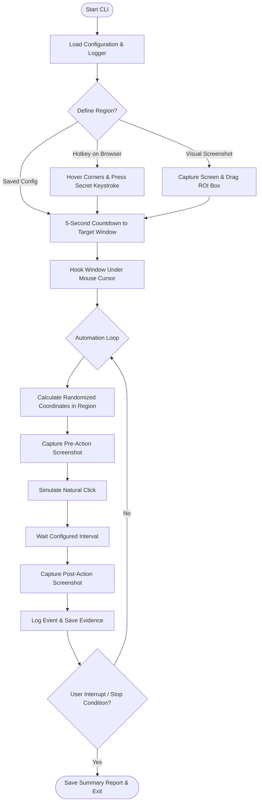
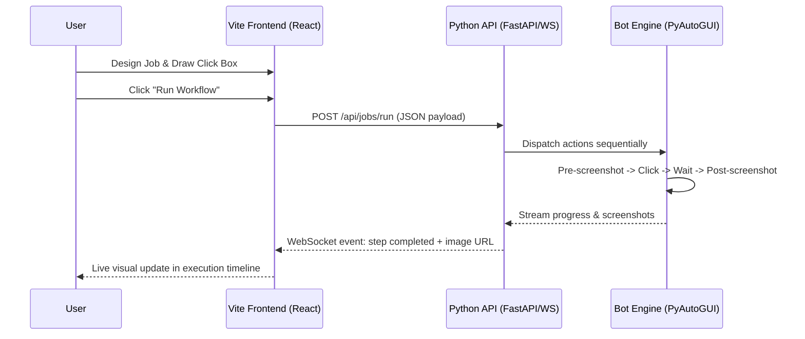

# ClickBot — Proof of Concept (PoC) Specification & Design

A flexible browser/desktop automation bot designed to hook targets, simulate human-like clicks, record evidence, and automate webpage tasks.

---

## 1. Core Objectives & Features

- **Window / Target Hooking**:
  - Automatically hook the target window/webpage under the mouse pointer after a configurable delay (e.g., 5-second countdown).
  - Track active window bounds and ensure operations stay constrained to the target browser session.
- **Interactive Region Definition Modes**:
  - **Live Browser Keystroke Capture**: Move the mouse over the browser and trigger a secret keystroke/hotkey (e.g. `Ctrl+Shift+1` for Top-Left corner, `Ctrl+Shift+2` for Bottom-Right corner) to calibrate the bounding box on the fly.
  - **Screenshot Edge Selector (Visual ROI)**: Grab an interactive screenshot of the target window or screen, then click-and-drag or pick edge corners (ROI selector using OpenCV/Tkinter/Pillow) to define the active click zone.
- **Human-like Clicking & Interaction**:
  - Click randomized points within defined rectangular regions (jitter / bounded box).
  - Configurable dwell times, pre-click hover delays, and human-like delays between actions.
  - Periodic or conditional re-clicking on the target page.
- **Evidence Collection & Logging**:
  - Capture timestamped full-screen or region-specific screenshots before and after actions.
  - Structured run logs (file + rich console output) and evidence output folders (`assets/evidence/YYYYMMDD_HHMMSS/`).
  - Optional metrics summary (actions performed, success rate, error traces).
- **Workflow Jobs & Action Pipelines**:
  - Define custom automation workflows composed of sequential steps:
    - `hook_target`: Attach to target window/tab.
    - `mouse_click`: Single, double, or randomized click inside an ROI.
    - `wait`: Fixed or randomized interval delay (dwell time).
    - `screenshot`: Capture visual state before/after an action for audit/evidence.
    - `loop` / `repeat`: Repeat a sequence with condition checks or iteration counts.
  - Workflows are defined declaratively in JSON/YAML for reusability.
- **Visual Workflow Builder (Vite + React UI)**:
  - Drag-and-drop or pipeline node editor to visually assemble, configure, and reorder jobs.
  - Interactive canvas overlay to preview captured screenshots and visually draw/resize click regions.
  - One-click trigger to execute jobs via a lightweight local backend API (FastAPI / WebSocket).

---

## 2. Architecture & Modules

```
clickBot/
├── assets/
│   ├── evidence/               # Stored screenshots & session artifacts
│   └── workflows/              # Saved JSON/YAML workflow job definitions
├── docs/
│   └── clickBot_poc.md         # This specification document
├── src/
│   ├── __init__.py
│   ├── config.py               # Settings (delays, regions, browser options)
│   ├── window_hook.py          # PyGetWindow / mouse-based window tracking
│   ├── region_selector.py      # Keystroke hotkey listener & visual screenshot ROI selector
│   ├── clicker.py              # PyAutoGUI click engine with randomization
│   ├── evidence.py             # Screenshot and artifact recorder
│   ├── engine.py               # Job executor running action sequences
│   ├── api.py                  # Local FastAPI / WebSocket bridge for Vite UI
│   └── bot.py                  # Main orchestration loop & CLI entry
├── ui/                         # Modern Vite-based Dashboard & Workflow Builder
│   ├── package.json
│   ├── vite.config.ts
│   ├── src/
│   │   ├── components/         # WorkflowBuilder, CanvasOverlay, StepCard, Logs
│   │   ├── hooks/              # useWorkflow, useLiveScreen
│   │   ├── types/              # Job, Step, Region schemas
│   │   └── App.tsx
│   └── index.html
├── tests/
│   └── test_clicker.py
├── requirements.txt
└── main.py                     # CLI entrypoint
```

---

## 3. Tech Stack & Dependencies

```text
# UI Automation & Window Management
pyautogui>=0.9.54
pygetwindow>=0.0.9
pillow>=10.0.0
keyboard>=0.13.5          # Global secret keystrokes / hotkeys
opencv-python>=4.8.0      # Optional visual ROI drag-and-drop selector

# Terminal UI & Logging
rich>=13.0.0

# Optional Web / Integration Layer (for advanced web tasks)
selenium>=4.20.0
pandas>=2.0.0
```

---

## 4. PoC Workflow



---

## 5. Prototype Implementation Snippet (Draft)

```python
import time
import random
import logging
from pathlib import Path
from datetime import datetime
import pyautogui as pag
import pygetwindow as gw
from rich.console import Console

console = Console()

class ClickBotPoC:
    def __init__(self, evidence_dir: str = "assets/evidence"):
        self.evidence_dir = Path(evidence_dir)
        self.evidence_dir.mkdir(parents=True, exist_ok=True)
        self.target_window = None

    def hook_window_under_cursor(self, delay: int = 5):
        """Countdown and capture window under mouse position."""
        console.print(f"[bold yellow]Hover mouse over target window. Hooking in {delay}s...[/bold yellow]")
        for sec in range(delay, 0, -1):
            console.print(f"[dim]T-{sec}...[/dim]")
            time.sleep(1)

        x, y = pag.position()
        windows = gw.getWindowsAt(x, y)
        if not windows:
            raise RuntimeError(f"No window found at coordinates ({x}, {y})")

        self.target_window = windows[0]
        console.print(f"[bold green]Hooked:[/bold green] {self.target_window.title} ({self.target_window.box})")
        return self.target_window

    def click_random_in_region(self, left: int, top: int, width: int, height: int):
        """Click a randomized coordinate within a bounded box."""
        target_x = random.randint(left, left + width)
        target_y = random.randint(top, top + height)

        pag.moveTo(target_x, target_y, duration=random.uniform(0.15, 0.45))
        pag.click()
        return target_x, target_y

    def capture_evidence(self, label: str = "action") -> Path:
        """Capture screenshot with timestamp."""
        timestamp = datetime.now().strftime("%Y%m%d_%H%M%S_%f")[:19]
        file_path = self.evidence_dir / f"{timestamp}_{label}.png"
        screenshot = pag.screenshot()
        screenshot.save(file_path)
        return file_path

    # --- Region Definition Modes ---

    def calibrate_region_via_hotkeys(self) -> dict:
        """
        Calibrate region in real-time over the live browser:
        1. Hover top-left corner -> press Ctrl+Shift+1
        2. Hover bottom-right corner -> press Ctrl+Shift+2
        """
        import keyboard
        console.print("[bold yellow]Mode 1: Live Keystroke Calibration[/bold yellow]")
        console.print("Hover mouse over [cyan]Top-Left[/cyan] edge and press [bold]Ctrl+Shift+1[/bold]...")
        keyboard.wait("ctrl+shift+1")
        p1 = pag.position()
        console.print(f"Top-Left marked at: {p1}")

        time.sleep(0.5)
        console.print("Hover mouse over [cyan]Bottom-Right[/cyan] edge and press [bold]Ctrl+Shift+2[/bold]...")
        keyboard.wait("ctrl+shift+2")
        p2 = pag.position()
        console.print(f"Bottom-Right marked at: {p2}")

        left = min(p1.x, p2.x)
        top = min(p1.y, p2.y)
        width = abs(p2.x - p1.x)
        height = abs(p2.y - p1.y)
        region = {"left": left, "top": top, "width": width, "height": height}
        console.print(f"[bold green]Region defined:[/bold green] {region}")
        return region

    def select_region_on_screenshot(self) -> dict:
        """
        Mode 2: Freeze screen with screenshot, let user drag/select bounding box.
        Uses cv2.selectROI or a lightweight Tkinter canvas overlay.
        """
        import cv2
        import numpy as np

        console.print("[bold yellow]Mode 2: Visual Screenshot ROI Selection[/bold yellow]")
        console.print("Capturing screen... Drag a box on the window and press ENTER or SPACE.")
        shot = pag.screenshot()
        img = cv2.cvtColor(np.array(shot), cv2.COLOR_RGB2BGR)

        # OpenCV ROI selector window: drag box, press SPACE/ENTER to confirm
        roi = cv2.selectROI("ClickBot - Define Click Region (Drag & Enter)", img, showCrosshair=True)
        cv2.destroyAllWindows()

        left, top, width, height = roi
        region = {"left": left, "top": top, "width": width, "height": height}
        console.print(f"[bold green]Region defined via screenshot:[/bold green] {region}")
        return region
```

---

## 6. Declarative Job Specification (Schema)

Workflows are saved as serialized JSON / YAML files:

```json
{
  "job_id": "job_daily_checkin",
  "name": "Webpage Daily Check-in",
  "iterations": 1,
  "steps": [
    {
      "step_id": "step_1",
      "action": "screenshot",
      "label": "initial_page_state"
    },
    {
      "step_id": "step_2",
      "action": "mouse_click",
      "region": { "left": 450, "top": 320, "width": 80, "height": 30 },
      "randomize": true,
      "button": "left",
      "clicks": 1
    },
    {
      "step_id": "step_3",
      "action": "wait",
      "duration_range": [2.5, 4.0]
    },
    {
      "step_id": "step_4",
      "action": "screenshot",
      "label": "post_click_confirmation"
    }
  ]
}
```

---

## 7. Vite UI Interface Specification

A sleek, lightweight web dashboard powered by **Vite + React + Tailwind + Lucide Icons**:

### Key UI Features

1. **Visual Step Pipeline (Drag & Drop)**:
   - Visual cards representing steps: `[📸 Screenshot] -> [🖱️ Mouse Click] -> [⏳ Wait] -> [🔁 Loop]`.
   - Re-order, duplicate, toggle enable/disable per step.
2. **Interactive Canvas Region Editor**:
   - Preview the latest screenshot of the target webpage directly on an HTML5 `<canvas>`.
   - Click and drag bounding boxes to assign coordinates to a `mouse_click` step with live visual feedback.
3. **Execution & Live Monitoring**:
   - **Play / Pause / Stop** controls with immediate fail-safe trigger.
   - Live streaming logs and side-by-side pre/post evidence gallery.
4. **Backend Bridge**:
   - A lightweight local FastAPI or WebSocket server in `src/api.py` that connects the Vite UI to the PyAutoGUI execution engine.



---

## 8. Next Steps & Enhancements

1. **Safety Controls**: Fail-safe hotkey (e.g., mouse to corner or `Esc`/`q` keyboard listener).
2. **Dynamic Element Matching**: Integrate OpenCV template matching or Selenium DOM targeting for precise web controls.
3. **Vite Scaffold**: Initialize the `ui/` directory with a responsive workflow designer.
4. **Structured Reporting**: Export session metrics to CSV / Google Sheets.
